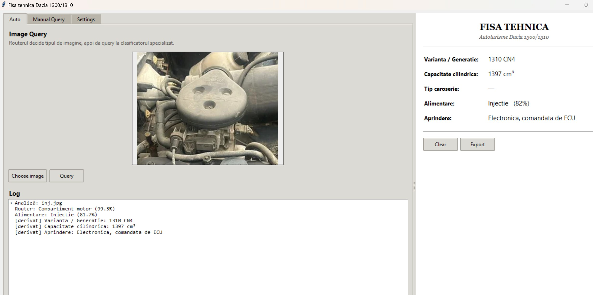
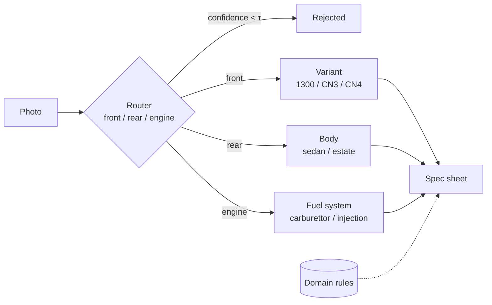
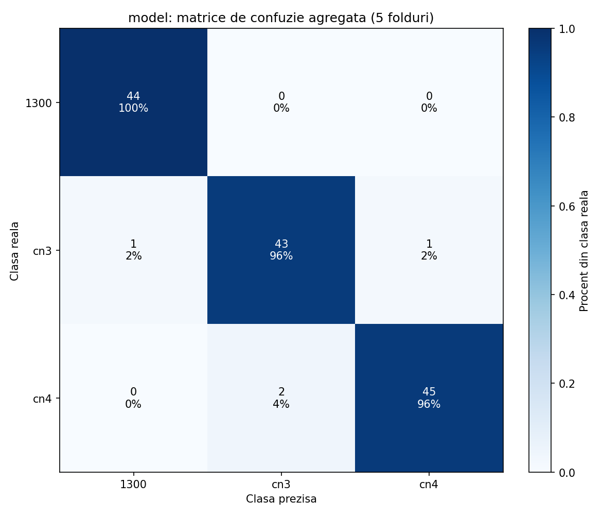
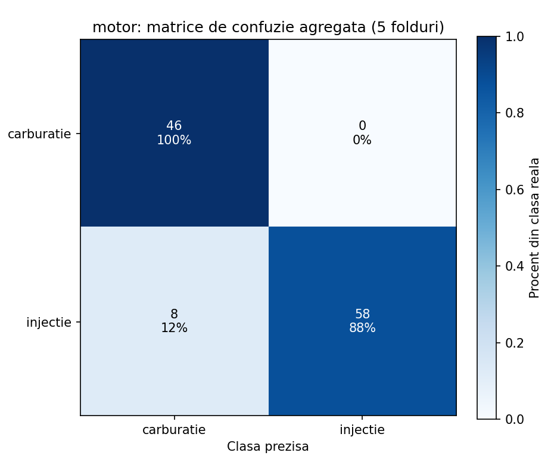

# Dacia 1300/1310: technical spec sheet from photos

A deep learning system that looks at photos of a Dacia 1300/1310, the most
common Romanian car of 1969–2004, and fills in its technical spec sheet:
model variant, body style, fuel system, plus the engine and ignition details
that follow from them.

This is my bachelor's thesis, *Determinarea automată a configurației tehnice a
autoturismelor Dacia 1300/1310 folosind Deep Learning* (Faculty of Mathematics
and Computer Science, University of Bucharest, 2026; supervisor Conf. Dr.
Claudia Mureșan). The thesis is in Romanian: [`thesis/teza.pdf`](thesis/teza.pdf).



## How it works

A single photo never shows everything. The variant is visible from the
front, the body style from the rear, and the fuel system only in the engine
bay. Instead of one monolithic classifier, a **router** first decides what
the photo shows. It then sends the photo to the **specialist** classifier
for that view.



- **Shared frozen backbone.** All four classifiers use the same
  [DINOv2](https://github.com/facebookresearch/dinov2) ViT-S/14, which is
  loaded once and never fine-tuned. Each image becomes a 384-dimensional
  L2-normalised embedding.
- **One linear layer per task** (under 1,200 parameters) is trained on top.
  With only 100–500 images per task, this overfits far less than fine-tuning
  a CNN, and it trains in seconds.
- **Flip augmentation and test-time augmentation.** Each embedding is also
  computed for the horizontally flipped image. Predictions average the two.
- **Reject threshold.** If the router's top probability is below τ (0.55 by
  default, adjustable in the app), the photo is rejected instead of guessed.
- **Domain rules** fill in specs that a photo can't show directly. For
  example, a detected 1300 implies the 1289 cm³ engine and Ducellier
  distributor, and fuel injection implies a 1310 CN4 with ECU-controlled
  ignition. These values are shown without a confidence score.

Training setup (identical for every task): 224×224 input with
pad-to-square, Adam (lr 1e-3, weight decay 1e-4), 200 full-batch epochs,
label smoothing 0.1, inverse-frequency class weights.

## Results

All numbers come from **5-fold cross-validation grouped by vehicle**
(`StratifiedGroupKFold`), so every fold is scored on cars the model never
saw during training. This matters: many photos show the same car, and an
early per-image 80/20 split reported 100% validation accuracy, which was
leakage rather than skill.

| Classifier                    | Classes | Images / vehicles | CV accuracy      |
|-------------------------------|:-------:|:-----------------:|:----------------:|
| Router (front/engine/rear)    | 3       | 512 / 417         | 98.9% ± 0.7%     |
| Body (sedan/estate)           | 2       | 264 / 220         | 91.6% ± 2.9%     |
| Variant (1300/CN3/CN4)        | 3       | 136 / 100         | 96.7% ± 3.3%     |
| Fuel system (carb/injection)  | 2       | 112 / 97          | 93.6% ± 10.5%    |

Per-fold scores, confusion matrices and per-class recall are in
[`results/cv_dinov2.txt`](results/cv_dinov2.txt). Training curves, fold bar
charts and confusion matrices for every task are in [`graphics/`](graphics/).

| Variant | Fuel system |
|:---:|:---:|
|  |  |

The fuel-system result is the least stable. One fold drops to 73% on only
about 20 validation images, so more engine-bay data is the main open item.
Section 7.4 of the thesis covers the other limitations.

> Re-running training on a different machine or scikit-learn version can
> assign vehicles to folds differently. Scores then move by about a
> percentage point, which is within the reported standard deviations.

## Running the app

Requires Python 3.10+ (developed on 3.12).

```bash
python -m venv .venv
source .venv/bin/activate        # Windows: .venv\Scripts\activate
pip install -r requirements.txt
python app/gui.py
```

The trained linear heads are included in [`models/`](models/) (a few KB
each). On first use, `torch.hub` downloads the DINOv2 backbone (about 85 MB),
which needs internet access. Tkinter ships with Python on Windows and macOS.
On Debian/Ubuntu, install it with `sudo apt install python3-tk`.

The app has three tabs next to a live spec sheet:

- **Auto** runs the router, then the right specialists, and fills in the
  sheet.
- **Manual Query** runs one specialist of your choice and shows the full
  probability distribution.
- **Settings** sets the reject threshold, the device (auto/cpu/cuda) and the
  models folder.

The filled-in sheet can be exported as `.txt`.

## Retraining

The photo dataset is not included because it was collected from third-party
sources. [`train/README.md`](train/README.md) documents the expected folder
layout and file naming. With data in place:

```bash
python scripts/group_vehicles.py propose   # suggest same-vehicle groups (review the HTML)
python scripts/group_vehicles.py apply     # write car<ID>__ prefixes, rebuild router data
python scripts/train_dinov2.py             # cross-validate + train all tasks
python scripts/train_dinov2.py motor       # ...or just some
```

Training writes `models/dinov2_<task>.pth`, `results/cv_dinov2.txt` and the
plots in `graphics/`. A GPU helps when extracting embeddings but isn't
required. The full run takes a few minutes on CPU.

## Repository layout

```
app/            Tkinter GUI (gui.py) and inference engine (inference.py)
dacia/          code shared by training and inference (preprocessing, backbone, data utils)
scripts/        training, vehicle grouping, router data generation
models/         trained linear heads, one per task
results/        cross-validation report
graphics/       training curves, per-fold accuracy, confusion matrices
thesis/         LaTeX source and compiled PDF (Romanian)
docs/           thesis defence slides
train/          dataset location (not included, see train/README.md)
legacy/resnet/  earlier ResNet-18 fine-tuning approach, kept for reference
```

The thesis builds with `latexmk -pdf teza.tex` from inside `thesis/`
(pdfLaTeX + biber).

### A note on language

The UI labels, code comments and thesis are in Romanian. Folder and class
names you will see:

| Romanian | English |
|---|---|
| fișă tehnică | spec sheet |
| față / spate | front / rear |
| caroserie: berlină / break | body: sedan / estate |
| motor: carburație / injecție | engine: carburettor / fuel injection |
| model / variantă | model variant |

## Acknowledgements

- The thesis template is based on [Gabriel Majeri's bachelor's
  thesis](https://github.com/GabrielMajeri/bachelors-thesis) (CC BY 4.0).
- DINOv2 is by Meta AI Research ([Oquab et al., 2024](https://arxiv.org/abs/2304.07193)).

## License

The code is released under the [MIT License](LICENSE). The thesis text,
figures and slides are © Focșa Mihai-Luca.
